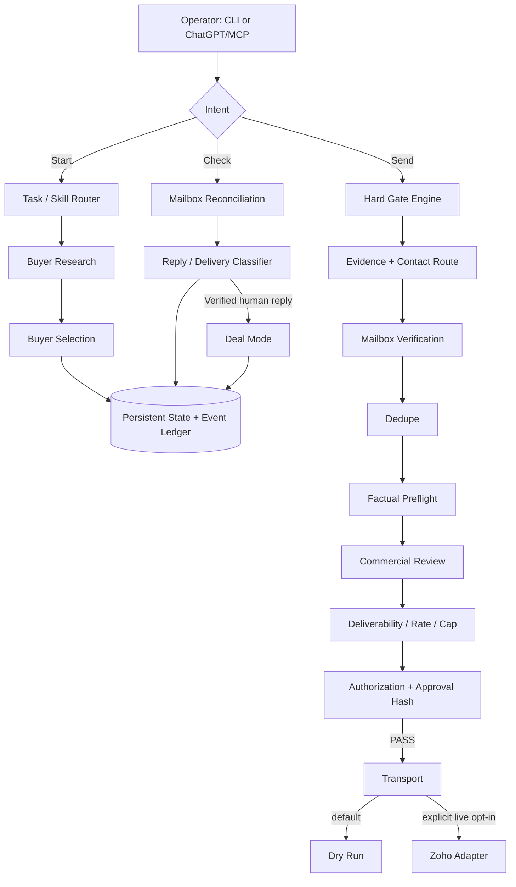

# Outbound OS

> Most AI outbound tools optimize for sending more. Outbound OS is built to know when **not** to send.

```text
Start.
Check.
Send.
```

Those are operator intents, not bypass commands.

Every outbound action still has to pass Buyer Selection, evidence checks, mailbox verification, dedupe, factual preflight, commercial review, deliverability/rate controls, explicit authorization, and an exact approval hash.

**Outbound OS is a free, MIT-licensed reference implementation of a decision-gated outbound workflow.** It is inspired by the workflow used in the private Zoho MCP operation, but this repository contains no private campaign data, deal state, credentials, or Git history from that project.

## Why this exists

A typical outbound stack asks: **How do we send more?**

Outbound OS starts earlier:

1. Is this organization worth contacting?
2. Is the evidence strong enough to justify outreach?
3. Is the route and mailbox verified?
4. Have we contacted the organization already?
5. Is every personalized claim supportable?
6. Is the exact message still the one that was reviewed and approved?
7. Is deliverability healthy enough to send now?
8. Did a human reply, making this a deal instead of a cold lead?

A failed hard gate means **STOP**.

## Run as an installable CLI

Node.js **22+** and Git are required. The source is [MIT licensed](LICENSE). **No mailbox credentials, ChatGPT account, or API keys are needed for the offline demo.**

### Try from source (recommended first run)

```bash
git clone https://github.com/RecepioHQ/outbound-os.git
cd outbound-os
npm ci
node bin/outbound-os.js --help
node bin/outbound-os.js demo --json
```

### Optional global command from a local package archive

```bash
npm pack
npm install --global ./outbound-os-0.2.0.tgz
outbound-os demo --json
```

The `.tgz` is built **locally from the checked-out source** and should be reviewed before installation. On Windows, use PowerShell with the same commands (or replace `./` with `.\\`). The archive-install path is verified on Windows with an isolated npm prefix. **The project is not claiming publication on the npm registry.**

**Do not use `npm install -g github:RecepioHQ/outbound-os` as a recommended path:** on one verified Windows/npm 10 installation it produced a dangling junction into npm's temporary Git clone. The packed archive avoids that observed issue.

The demo uses reserved example domains, a mock mailbox and a dry-run transport: **no real emails are sent**. For real operations, follow [provider configuration](docs/provider-adapters.md) and [security requirements](SECURITY.md). The `start`, `check` and `send` commands still invoke the existing state, verification and hard-gate code; installing the CLI grants no permission to bypass them.

## 60-second demo

Requirements: Node.js 22+.

```bash
npm install
npm test
npm run demo
```

The demo is entirely synthetic and makes no network calls. It walks through:

```text
Synthetic buyer
      ↓
Buyer Selection → READY
      ↓
Verified evidence + mailbox + dedupe + review gates
      ↓
Dry-run send → SIMULATED (not a live send)
      ↓
Synthetic human reply
      ↓
Cold eligibility stops
      ↓
Deal Mode → engaged
```

Example output:

```json
{
  "buyer_state": "READY",
  "send_decision": "PASS",
  "transport_status": "simulated",
  "live_sent": false,
  "cold_eligible_after_reply": false,
  "deal_stage": "engaged"
}
```

## Architecture



The model can recommend work, but it cannot override the mechanical gate engine beneath it.

## Buyer Selection

The public engine evaluates four evidence-backed dimensions:

- **Strategic fit** — is there a credible reason the organization should care?
- **Commercial-capacity evidence** — is there attributable evidence that outreach is commercially justified?
- **Decision access** — is there a credible route to an appropriate decision maker or official channel?
- **Trigger / timing evidence** — is there a reason the outreach is timely?

Evidence is explicitly classified as `VERIFIED`, `INFERRED`, or `UNKNOWN`.

**UNKNOWN never becomes a positive score just because the system needs more volume.**

Results are `READY`, `HOLD`, or `SKIP`, with inspectable reasons.

See [docs/buyer-selection.md](docs/buyer-selection.md).

## Hard gates

The default send chain is fail-closed:

| Gate | Failure behavior |
| --- | --- |
| Buyer Selection | HOLD / BLOCK |
| Evidence quality | BLOCK |
| Contact route | BLOCK |
| Mailbox verification | BLOCK |
| Organization/contact dedupe | BLOCK |
| Factual personalization | BLOCK |
| Preflight | BLOCK |
| Commercial review | BLOCK |
| Deliverability health | BLOCK |
| Rate / volume cap | BLOCK |
| Explicit authorization | HOLD |
| Exact approval hash | BLOCK |

Strict mailbox verification passes only `valid`. `invalid`, `catch_all`, `unknown`, and `error` are blocked by default.

Changing the recipient, subject, plain-text body, or HTML after approval invalidates the approval hash.

See [docs/hard-gates.md](docs/hard-gates.md).

## Persistent state — not chat memory

Operational state lives outside the conversation:

- append-only JSONL lifecycle ledger;
- derived JSON state projection written atomically;
- organization-level and contact-level dedupe;
- persistent Deal Mode state after a human reply.

By default runtime state is stored under `state/`, which is excluded from Git. You can override it with `OUTBOUND_OS_DATA_DIR`.

A new ChatGPT/MCP session can reload the same state instead of reconstructing a deal from conversational memory.

See [docs/state-and-ledger.md](docs/state-and-ledger.md).

## Deal Mode

A verified human reply removes the organization from cold eligibility and creates or updates a deal record containing fields such as:

- latest human reply;
- stage;
- verified facts;
- inferred context;
- unknowns;
- objections;
- pricing context;
- commitments;
- next justified action.

Time alone does not advance a deal stage.

See [docs/deal-mode.md](docs/deal-mode.md).

## Skills

The repository separates task discipline instead of relying on one catch-all prompt:

- `buyer-research` — attributable evidence, no invented authority/budget/intent;
- `cold-outreach` — verified facts plus all outbound gates;
- `delivery-recovery` — permanent-vs-temporary delivery handling;
- `engaged-deal` — human-reply workflow and deal context.

The skills guide behavior. They do **not** bypass the mechanical rules in code.

## Zoho Mail adapter

Outbound OS includes a public-safe Zoho Mail adapter built against documented Zoho APIs.

It supports:

- OAuth refresh-token exchange;
- mailbox reads with limited retry on clearly transient read failures;
- conservative normalization of known-contact human replies, common auto-replies, permanent delivery failures, and temporary delays;
- exact approved-message sending;
- no blind retry after an ambiguous send mutation;
- post-send reconciliation by returned message ID.

Unmatched inbox mail is ignored rather than being promoted into a deal.

Live sending is disabled unless all required provider configuration is present **and**:

```text
OUTBOUND_OS_LIVE_SEND=1
```

See [.env.example](.env.example) and [docs/provider-adapters.md](docs/provider-adapters.md).

## ChatGPT / MCP

The optional `chatgpt/` package exposes the same three intents as MCP tools:

- `start`
- `check`
- `send`

The MCP server binds to `127.0.0.1` by default. That is intentional: mailbox reads expose private data, and sending email creates an irreversible external action.

```bash
cd chatgpt
npm install
npm start
```

For development, use MCP Inspector or a supported private/Secure MCP Tunnel workflow. A remote public MCP deployment must add a proper authentication/authorization boundary before exposing these tools.

`chatgpt/plugin-template/` contains a portable Agent Plugins packaging example with an intentionally non-working `.example` MCP URL.

**ChatGPT capabilities vary by plan, workspace, region, admin settings, and action type. Do not assume that ChatGPT Plus alone guarantees custom live write/send actions.** The local CLI remains the universal fallback.

See [chatgpt/README.md](chatgpt/README.md).

## CLI

```bash
node src/cli.js start --json
node src/cli.js check --json
node src/cli.js send --json
node src/cli.js send --json --input path/to/prepared-send-context.json
```

`--input` accepts a prepared JSON context for any intent. `send` does not mean “send unconditionally”: with no prepared, approved context it fails closed, and the same hard gates run whether the caller is CLI or MCP. The synthetic demo is the easiest way to inspect a complete passing pipeline.

## Free software and external costs

Outbound OS itself is MIT-licensed and this project does not charge a SaaS subscription, per-lead credit, or per-sequence fee.

That does **not** mean the complete operating environment is cost-free. Depending on your setup, you may still pay for:

- ChatGPT or another compatible operator environment;
- Zoho Mail or another mailbox provider;
- mailbox-verification services;
- hosting, OAuth, or other APIs you connect.

There are no claims of unlimited ChatGPT usage or guaranteed reply/revenue improvements.

## Release security

Before publication, the project scans for:

- private-project filenames/directories;
- non-synthetic email addresses;
- credential/token/private-key patterns;
- secret-bearing environment files;
- private/internal URLs;
- long provider/message identifiers;
- local absolute user paths;
- private campaign names supplied through a local denylist;
- accidental pre-publication Git history.

Run the contributor scan with:

```bash
npm run scan:release
```

See [SECURITY.md](SECURITY.md).

## Current scope

This is a **reference implementation**, not a hosted multi-tenant SaaS and not a mass-mailing product.

v0.2.0 intentionally does not provide:

- autonomous background/scheduled sending;
- a hosted OAuth service for public multi-user MCP access;
- a built-in third-party mailbox-verification provider account;
- guarantees that every possible DSN/auto-reply format is classified;
- guaranteed replies, pipeline, revenue, or deliverability outcomes.

Use the hard gates as safeguards, not as a substitute for applicable law, provider terms, or responsible outreach practices.

## Development

```bash
npm test
npm run demo
npm run scan:release
npm run manifest:release
```

See [CONTRIBUTING.md](CONTRIBUTING.md).

## License

MIT. See [LICENSE](LICENSE).
