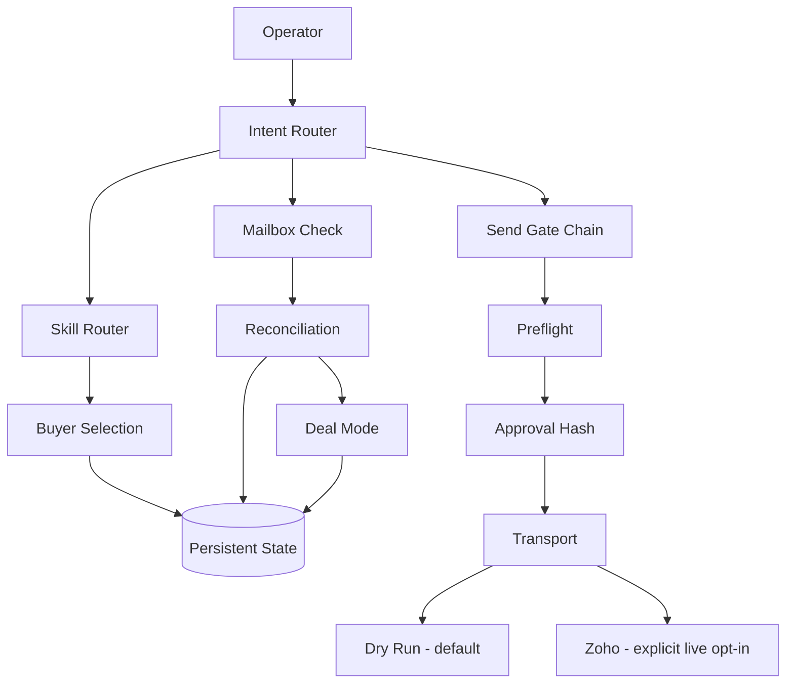

# Architecture

Outbound OS separates model-guided workflow decisions from mechanical enforcement.

## Operator surfaces

Two surfaces call the same core engine:

- Local CLI: `start`, `check`, `send`.
- Optional ChatGPT MCP server: `start`, `check`, `send`.

Neither surface has a privileged send path.

## Core flow

## Authority boundaries

### Model / skill layer

Skills can research, structure evidence, suggest drafts, and recommend next actions. Their output is advisory until the core engine validates it.

### Mechanical gate layer

The gate engine enforces:

- Buyer Selection readiness;
- evidence quality;
- contact-route suitability;
- strict mailbox verification;
- organization/contact dedupe;
- factual-personalization support;
- preflight;
- commercial review status;
- deliverability/rate/cap health;
- explicit authorization;
- exact approval-hash integrity.

The model cannot override these gates through wording or intent selection.

### Transport layer

Dry-run is the default. The Zoho adapter is reachable for live mutation only when live configuration is explicitly complete. A mutation is attempted once; an ambiguous result requires reconciliation rather than an automatic retry.

## State model

Runtime state is stored outside conversational memory:

- `state/state.json` — current derived projection, written atomically;
- `state/events.jsonl` — append-only lifecycle events.

The default directory is ignored by Git and can be overridden with `OUTBOUND_OS_DATA_DIR`.

Organization identity prefers canonical domains. Contact identity uses canonical lowercase email addresses. Provider event IDs are replay-safe.

## Mailbox reconciliation

A mailbox adapter returns normalized events. For Zoho, v0.1 performs conservative normalization from documented message-list fields such as sender, subject, summary, message ID, thread ID, and receive time.

Events are correlated only to contacts already present in canonical state. Unmatched inbox mail is ignored rather than being promoted into a deal.

A verified human reply immediately makes the organization cold-ineligible and creates/updates Deal Mode. Permanent bounces block retry to the exact failed address; temporary delays remain temporary.

## ChatGPT boundary

The optional MCP server is a thin wrapper over the same Action API used elsewhere. Tool annotations describe actual risk:

- `start`: read-only, bounded, idempotent;
- `check`: externally read-only in v0.1, bounded, idempotent;
- `send`: write, irreversible, open-world, non-idempotent.

The MCP server binds to loopback by default. Public remote deployment requires an authentication/authorization layer that is intentionally outside the v0.1 reference implementation.

## Public/private boundary

This repository is a clean-room implementation. It does not import private Zoho MCP history, live state, buyer research, deal memory, credentials, or production messages. Release scans and a publication manifest provide additional verification before release.